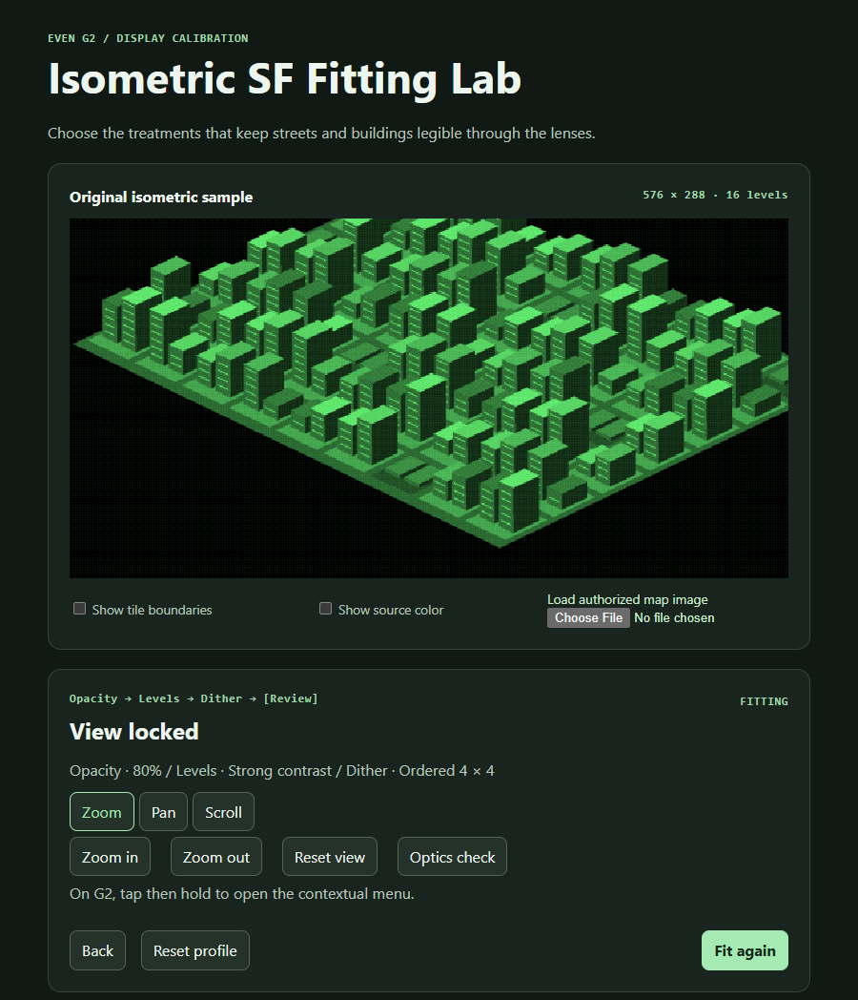
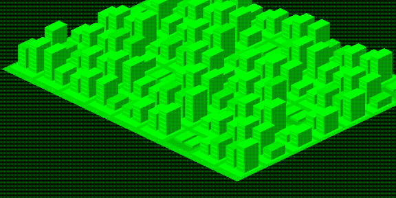
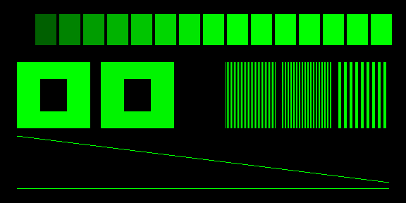

# Isometric SF G2 Fitting Lab

A map viewer and display fitting prototype for the Even G2. It opens in downtown San Francisco with the display profile locked at **80% opacity, Strong Contrast, and Ordered 4 × 4**. Move around the map with the glasses or phone controls, or select **Fit again** to adjust the display profile.

## Screenshots

The screenshots use the included original calibration map. Open the app with `?sample=1` to reproduce them.

| Web app | Even Hub simulator |
| --- | --- |
|  |  |



## Run

Use Node 24. From this project folder, run:

```sh
npm ci
npm run dev
```

Open http://localhost:5173. Select an A–D starting preset on the phone, then use the slider or arrow keys to adjust in 2.5-point increments on a 0–100 scale. Opacity controls image brightness, Levels adjusts gamma within the chosen black and white points, and Dither adjusts the selected pattern’s strength. Raising Dither from None uses ordered 4 × 4. Use **Confirm choice** after each round and **Save profile** in Review. A saved profile is restored in the same browser or Even Hub webview. An imported image stays in memory for the current session.

## Try on Even G2

1. Pair the G2 in the Even Realities app and connect the phone and computer to the same network.
2. With the dev server running, substitute the computer’s LAN address in the command below. Allow local connections to the dev server if Windows prompts you.
3. Scan the generated QR in the Even app’s Developer Center and open the preview.
4. Swipe up or down on the ring or temple to adjust by 2.5 points. Wait for the frame to settle, then hold to lock the setting and advance. Holding in Dither saves the profile and clears the fitting cue for a full map view. Double-press goes back.
5. With the view locked, tap then hold to open the glasses contextual menu. Select **Zoom** for in/out, **Pan** for right/left, or **Scroll** for up/down. The phone has matching mode and direction buttons. The custom menu requires Even App 2.2.9 or later.

Zoom out before traversing long stretches of the map. **Reset view** on the phone returns to the original downtown view.

## Check the image on physical G2 lenses

1. With the map locked, tap then hold and select **Optics check**. Swipe up for the reference target and down for the map at the same position and zoom. Select **Optics check** again to return to navigation.
2. In dim and bright surroundings, check whether the black cutouts in the bright blocks stay dark, which brightness steps you can distinguish, and whether the 1-, 2-, and 4-pixel bars stay separate. Look for a break where the test marks cross the tile joins.
3. Swipe down and check whether bright roofs wash out neighboring streets and whether you can still pick out thin building edges. Use **Fit again** to compare settings if those details are hard to read.

Record the ambient conditions, G2 brightness, finest bars you can distinguish, any visible glow, and which map profile preserves the most detail. Physical G2 results are pending. The simulator screenshots show the submitted frame and cannot establish lens brightness or light bleed.

```sh
npx --package @evenrealities/evenhub-cli evenhub qr --url http://YOUR-LAN-IP:5173
```

Official simulator:

```sh
npx --package @evenrealities/evenhub-simulator evenhub-simulator http://localhost:5173
```

## Source and display

- The app reads the bounds from [Justin Chavez’s Isometric SF](https://justinchavez.github.io/sf-isometric-demo/) and fetches the visible 512 px tiles directly from the source site. It uses the site’s overview at wide zoom levels. The artwork stays on the original site and is absent from this repository. If the source is unavailable at launch, the original calibration sample appears with a notice. **Load authorized map image** accepts a 2:1 export or center-crops a larger image to fit.
- The renderer computes luminance, applies opacity against black and Levels, then quantizes with the selected dithering treatment. It processes the whole 576 × 288 frame before splitting it into top-left, top-right, bottom-right, and bottom-left tiles. This preserves diffusion across boundaries. The SDK receives four lossless grayscale PNGs in sequence. Pending frames coalesce during a transfer. Tile updates may briefly show a mixed frame on hardware.
- In the phone preview, **Show tile boundaries** draws guides over the joins. **Show source color** changes only the phone preview. The display profile is selected by eye on the glasses.

## Verification

```sh
npm test
npm run build
```

Automated tests check exact tile reassembly and deterministic 16-level output. The mobile-sized browser check covers the full fitting flow, keyboard controls, tile guides, local image loading, and profile persistence. The official simulator (0.9.5) showed one continuous map across four containers and reached the locked view after the three holds.

Physical G2 testing is the acceptance step. Compare street edges, rooftops and shadow detail in dim and bright ambient light. Check all four joins while swiping and observe how long a full frame takes to settle. Record the preferred opacity, Levels and dither settings on the actual SF crop. The simulator can exercise transfers and input, while lens readability and transfer timing need the physical device.

References: [Even Hub testing](https://hub.evenrealities.com/docs/test), [SDK reference](https://github.com/even-realities/everything-evenhub/blob/main/plugins/everything-evenhub/skills/sdk-reference/SKILL.md), [SF Isometric source repository](https://github.com/JustinChavez/sf-isometric-demo).
